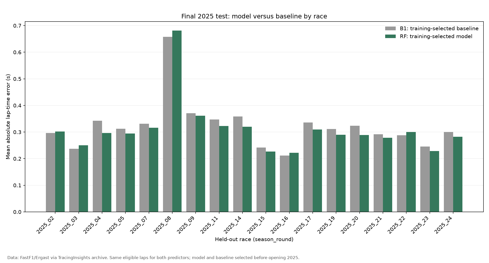
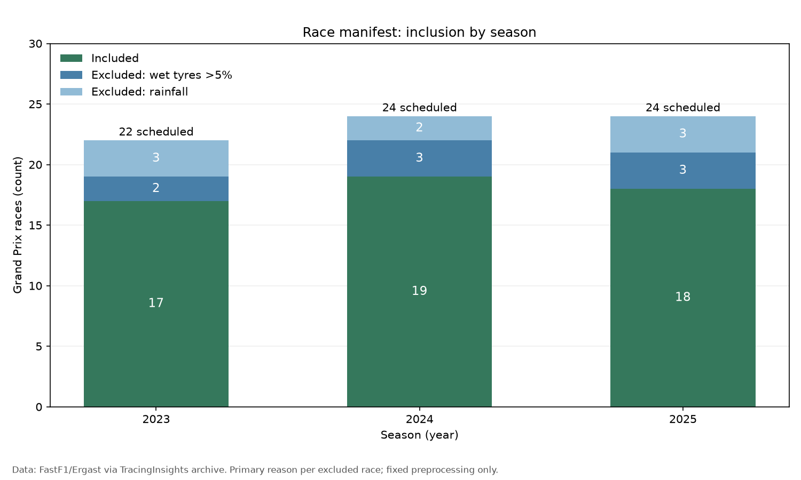
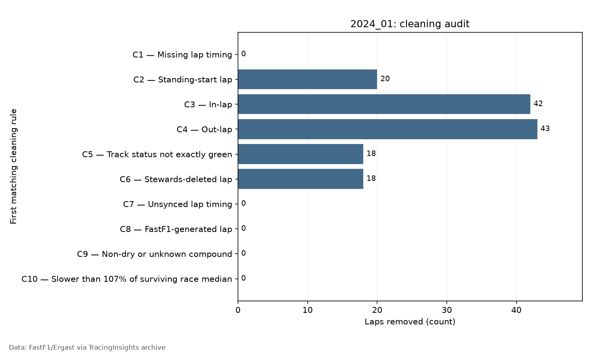
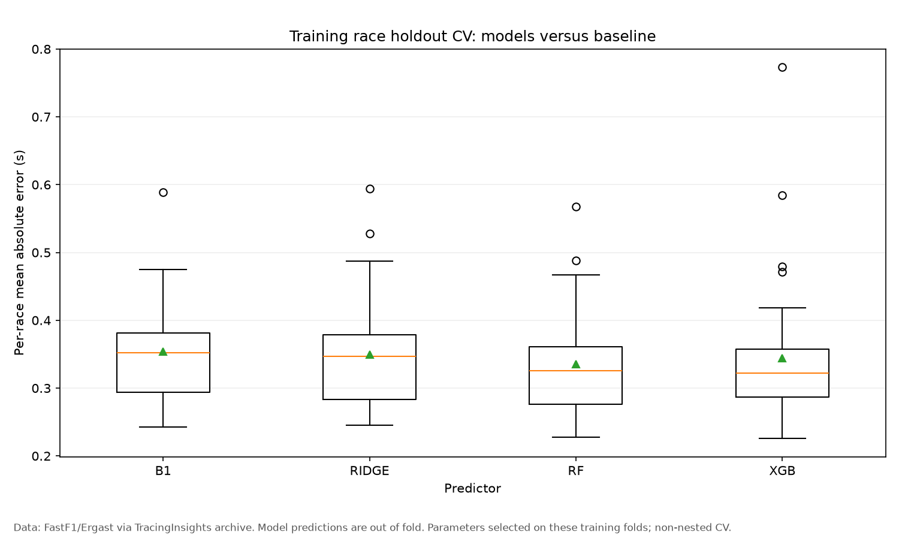
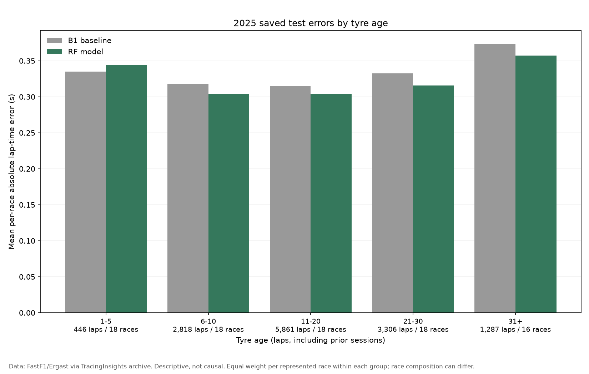
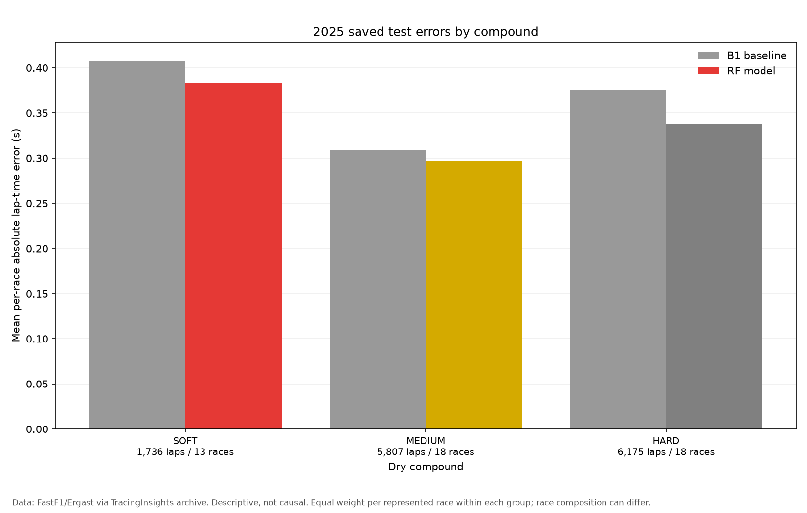

# F1 Race Pace Forecasting

## Summary

Predict the next clean race lap from information available before it starts. This
Python project turns free FastF1-derived timing archives into an audited dataset,
compares four simple baselines with Ridge, Random Forest and XGBoost, and evaluates
the frozen models on a separate season. It covers 54 included dry races from
2023–2025, with 25,336 training rows and 13,718 held-out 2025 rows. The output is
a reproducible forecasting study with tests, tables and figures—not a pit-strategy
tool or a measurement of remaining tyre grip.

## Key result

**Random Forest reduced mean per-race MAE from 0.322424 s to
0.309541 s versus the last-lap baseline: 4.00% (0.012883 s), winning
13 of 18 test races.** The model and baseline were chosen using 2023–2024
training results before opening 2025. It lost the other five races; the improvement
is modest and no statistical-significance claim is made.

The 2025 test set **has been opened**. Results are retained in the
[experiment log](EXPERIMENT_LOG.md), including losses and earlier failed runs.



## Why this is hard

Tyre degradation is declining tyre **performance**; tyre wear is physical rubber
loss. They are related, but public timing data does not measure rubber or remaining
grip. Lap time combines tyre ageing, fuel burn, traffic, pace management, track
evolution and weather. Slower laps do not automatically imply degradation, and
performance does not always decline smoothly. This project forecasts pace
associated with tyre age; it does **not** isolate a causal degradation effect.

## Data and cleaning

The free path uses public [TracingInsights archives](https://github.com/TracingInsights)
derived from FastF1, with separate weather and race-control files. The packaged
[archive catalog](src/f1pace/archive_catalog.json) fixes source commits, URLs and
SHA-256 hashes for four files per race across 70 scheduled Grand Prix sessions.
Downloads are verified and cached; no telemetry, OpenF1 endpoint, account or paid
service is used by this path. Direct FastF1 loading remains optional but is not the
source used for these results.

| Season | Split | Included / scheduled races | Clean laps | Eligible predictions |
|---|---|---:|---:|---:|
| 2023 | train | 17/22 | 15,155 | 11,197 |
| 2024 | train | 19/24 | 17,742 | 14,139 |
| 2025 | test | 18/24 | 17,403 | 13,718 |

Races are excluded if any rainfall is recorded or more than 5% of raw laps use
intermediate/wet tyres. The [manifest](reports/tables/race_manifest.csv) retains
decisions and reasons. Sixteen races have diagnostic flags in the
[review table](reports/tables/race_manifest_review.csv); no manual overrides were
applied. Flags do not automatically exclude a race.



Lap cleaning removes, in order: missing lap times; standing-start laps; pit-in and
pit-out laps; any status other than exactly `"1"`; deleted laps; unsynchronised
laps; generated laps; non-dry compounds; and laps slower than 107% of that race's
median after the preceding rules. Each lap is charged to its first removal rule.
Original lap and stint numbers are preserved. Weather is joined backward at lap
start, never from a later sample.

`TrackStatus` is a string of all statuses during a lap: `1` normal, `2` yellow,
`4` safety car, `5` red flag, `6` virtual safety car deployed and `7` virtual safety
car ending. Code `3` is undocumented; no meaning is assumed. These meanings were
checked against the pinned FastF1 3.8.3 `track_status_data` docstring. A combined
status such as `"12"` is excluded. `IsAccurate` concerns timing synchronisation,
not the precision of the lap-time value.



The example audit is for one race; [audit_all_races.csv](reports/tables/audit_all_races.csv)
contains the full audit. The archive publisher applies official Ergast/Jolpica
lap-time/position corrections and exports durations at millisecond precision.
This is an audit of those exports, not untouched native FastF1 sessions. Local
raw-cache provenance retains source attribution and hashes. The separate source
licence must be respected when redistributing data; data is not included here.

## Method

For lap *t*, the previous three laps must be clean, consecutive, and in the same
driver/race/stint. The fixed inputs combine their times and trend with prior
stint slope/count, tyre age, lap number, stint, compound, fresh-tyre flag,
driver/team/circuit, and weather at lap start. Tyre age includes earlier-session
use. Expanding stint statistics use only laps strictly before *t*.

Models learn a delta from recent pace:

```text
target_delta = lap_time_s - mean_last3
predicted_lap_time_s = mean_last3 + predicted_delta
```

| Baseline | Prediction |
|---|---|
| B1 | Last clean lap time |
| B2 | Mean of the previous three clean laps |
| B3 | Mean of the previous five consecutive same-stint clean laps; otherwise B2 |
| B4 | OLS trend through all earlier clean stint laps, extrapolated to lap t |

B1 was strongest on training races, contrary to the initial B4 hypothesis.
B3 falls back on 2,051/13,718 test rows (14.95%). Optional lag4/lag5
are baseline-only inputs. No current-lap time is a model feature.

Ridge scales numeric inputs; tree models pass them through. All models use
`OneHotEncoder(handle_unknown="ignore")` for categories, inside each fitted
pipeline. Fixed small grids and seed 42 are used. Full grids are in
[models.py](src/f1pace/models.py); the resulting configurations are:

| Predictor | Training OOF mean race MAE (s) | Configuration selected on training |
|---|---:|---|
| Random Forest | 0.335030 | `max_depth=12`, `min_samples_leaf=20`, 300 trees |
| XGBoost | 0.343791 | `learning_rate=0.03`, `max_depth=3`, 300 trees |
| Ridge | 0.349495 | `alpha=100` |
| B1: last lap | 0.353741 | Previous lap time; no fitting |



## Validation design

Training uses 2023–2024 races, with five-fold `GroupKFold` grouped by `race_id`.
Whole races are held out; laps are never randomly split. Encoders and scalers fit
inside each training fold. Hyperparameters are selected by negative-MAE grid
search; the best ML configuration is selected by mean per-race out-of-fold MAE.
Parameters and OOF predictions use the same folds, so these are **non-nested
development estimates**, not independent final performance estimates.

Each selected pipeline is refitted on all training rows before one final 2025
evaluation. All four baselines and three models use exactly the same eligible
test rows. Main results give every race equal weight; SD is sample SD across
races, not a confidence interval. Predictions are one lap ahead with observed
prior lap times, not recursive multi-lap forecasts.

The [leakage test](tests/test_no_leakage.py) changes lap *t* and every later lap,
then checks that all model inputs for *t* remain identical. Other tests cover
history gaps, stint boundaries, race separation, weather alignment, cache hashes,
the test-opening guard and error aggregation. Validation-fold permutation
importance is saved as [fig08](reports/figures/fig08_feature_importance_cv.png);
it measures predictive association, not causation.

## Results table

Final 2025 results: 13,718 eligible laps across 18 races. Lower MAE is better;
negative improvement means worse than B1.

| Predictor | Mean MAE (s) | Median (s) | SD (s) | Improvement vs B1 | Races won / 18 |
|---|---:|---:|---:|---:|---:|
| Random Forest | 0.309541 | 0.295355 | 0.099626 | +4.00% | 13/18 |
| XGBoost | 0.318468 | 0.299242 | 0.102769 | +1.23% | 11/18 |
| Ridge | 0.320331 | 0.302939 | 0.099508 | +0.65% | 13/18 |
| B1: last lap | 0.322424 | 0.311816 | 0.094861 | — | — |
| B2: mean 3 | 0.334719 | 0.317821 | 0.109425 | -3.81% | 6/18 |
| B3: mean 5 | 0.355633 | 0.337784 | 0.120412 | -10.30% | 2/18 |
| B4: stint trend | 0.433867 | 0.387391 | 0.151603 | -34.56% | 0/18 |

Random Forest lost to B1 at Chinese Grand Prix, Japanese Grand Prix, Monaco Grand Prix, Italian Grand Prix, Las Vegas Grand Prix.
All ML models lost individual races. B4 was worse than B1 on every test race;
the simple expanding linear trend was not the strongest predictor here.

Full precision: [test_summary.csv](reports/tables/test_summary.csv) and
[test_results_by_race.csv](reports/tables/test_results_by_race.csv).
Training evidence: [cv_summary.csv](reports/tables/cv_summary.csv) and
[baseline summary](reports/tables/baselines_train_summary.csv).

## Error analysis

The frozen RF/B1 comparison uses saved predictions; analysis never refits or
predicts again. Every group table includes lap/race counts, equal-race mean MAE,
pooled lap MAE, gains and race wins/losses/ties.

- At tyre ages 1–5, RF was worse: 0.3439 s versus
  0.3353 s for B1 (446 laps). It improved in each older bucket.
- RF improved for all three compound groups. Race composition differs: SOFT
  covers 13 races, versus 18 for HARD/MEDIUM.
- Gain was 0.0066 s in the early clean-history group versus
  0.0163 s in the late group. These mean fewer than 10 versus at least
  10 **prior clean stint laps**; they are a proxy, not physical stint age.
- Gain was 0.0043 s for nonpositive prior stint slope versus
  0.0303 s for positive slope. Rising historical lap times do not prove degradation.
- The largest circuit gain was Sakhir (+0.046420 s); the largest
  loss was Monaco (-0.023345 s). See [all circuits](reports/tables/error_by_circuit.csv).





The five fixed age buckets are 1–5, 6–10, 11–20, 21–30 and 31+ laps. Each
figure averages equally over races represented in that group. These breakdowns
do not isolate the incremental contribution of tyre age; that would require a
separate, properly validated ablation study.

## Limitations

- Eligibility is retrospective: the current lap must survive cleaning, including
  the full-race median outlier rule. Results describe clean dry racing, not all
  future laps whose cleanliness is unknown at prediction time.
- Only 18 dry test races from one season are evaluated. Laps within a race are
  correlated; no significance test or uncertainty interval is claimed.
- Archive corrections, export precision and eligibility decisions constrain the
  interpretation. The 16 manifest review flags remain visible, with no manual
  overrides. Source availability may change despite pinned commits and hashes.
- Fuel load, traffic and driver intent are not observed directly. Tyre age is
  associated with pace; it does not measure wear, grip or causal degradation.
- Fixed history requirements drop laps after gaps and pit stops. Some subgroup
  results have little support and groups can cover different races.
- Development CV is non-nested. The test set is already opened; changing the
  model based on these results would require a new independent evaluation.

## Reproduce

Use Windows PowerShell, including the VS Code integrated terminal, from a fresh
source directory. Python 3.13.2 is the tested interpreter; package metadata allows
3.11+. Runtime versions are pinned in [pyproject.toml](pyproject.toml). Run each
line separately:

```powershell
python -m venv .venv
.venv\Scripts\Activate.ps1
python -m pip install --upgrade pip
python -m pip install -e ".[dev]"
python -m pytest -q
python -m pip check
```

Run the stages in order. The first data run downloads the public pinned files;
subsequent runs verify and reuse the cache. Training runs the complete prescribed
grids and can take time. `--estimator-jobs 1` avoids Windows worker-pool failures
seen in the restricted development environment without reducing the grids.

```powershell
python scripts/01_explore_one_race.py --year 2024 --round 1 --source archive
python scripts/02_build_manifest.py --source archive
python scripts/03_build_dataset.py --source archive --part all
python scripts/04_run_baselines.py
python scripts/05_train_models.py --estimator-jobs 1
python scripts/06_final_test.py
python scripts/07_error_analysis.py
```

Script 03 also accepts `--part clean` or `--part features`. Fixed 2025 preparation
does not select models; scripts 04/05 read training rows only. Scripts append
measured results and commands to the experiment log. Do not overwrite the original
study's artifacts to experiment with new modelling choices.

Script 06 writes `models/TEST_OPENED.txt` before reading test rows and refuses
repeat evaluation. An intentional reproduction of an already opened test uses
`python scripts/06_final_test.py --i-understand-rerun`; it is logged as a deviation,
not a fresh holdout. Never remove the marker to bypass the guard. If results
already exist, script 07 alone is sufficient for error analysis.

**Verification scope:** 153 tests pass in both the original and a clean,
offline-installed environment; dependency checks pass and all local README links
resolve. All scripts completed in a separate source copy using the verified raw
cache. The 23 comparison CSVs, four Parquets, CV scores/parameters and model
selection reproduced the original results; all 11 figures regenerated. Original
models, results and test marker remained unchanged. At verification time, the
supplied workspace had no Git metadata, and the session could not reach the pinned
GitHub input (WinError 10061). A literal online fresh clone and cold
download remain **unverified** (a fresh offline dependency install passed); the corresponding PRD checkbox is left
open rather than inferred from cached reproduction. See the final Phase 8 entry
in [EXPERIMENT_LOG.md](EXPERIMENT_LOG.md) for exact reproduction outcomes.

Data, caches, fitted models and local environments are ignored by Git. The saved
CSV reports and PNG figures are small review artifacts; original data must be
downloaded or supplied as a hash-verified cache. No hosted repository URL is
assumed by these instructions.

## Project structure

```text
src/f1pace/                  reusable loading, cleaning, features and evaluation
  archive.py                 verified free archive adapter
  archive_catalog.json       immutable sources and SHA-256 hashes
  config.py                  paths, seasons, thresholds and seed
  manifest.py, dataset.py    race eligibility and clean dataset assembly
  features.py, baselines.py  past-only features and B1–B4
  models.py, evaluate.py     pipelines, grouped CV and error metrics
  final_test.py              one-time final evaluation guard
  error_analysis.py         saved-prediction breakdowns
  plots.py, reporting.py     figures and append-only experiment entries
scripts/01_...07_*.py        numbered pipeline entry points
tests/                      synthetic unit and integration tests
reports/tables/             audit, manifest, CV, test and breakdown CSVs
reports/figures/            eleven saved PNG figures
data/                       raw cache and processed Parquet (ignored)
models/                     fitted pipelines, selection and test marker (ignored)
EXPERIMENT_LOG.md            measured results, provenance and deviations
PRD.md                      scope and evidence-based completion checklist
IMPLEMENTATION_GUIDE.md      implementation contracts and phase plan
```

Portfolio bullet: Built a leakage-safe next-lap forecasting pipeline across
54 dry F1 races (2023–2025); a training-selected Random Forest reduced mean
per-race MAE by 4.00% versus the last-lap baseline on 18 held-out 2025 races,
with error analysis retaining failures on young tyres and individual circuits.
